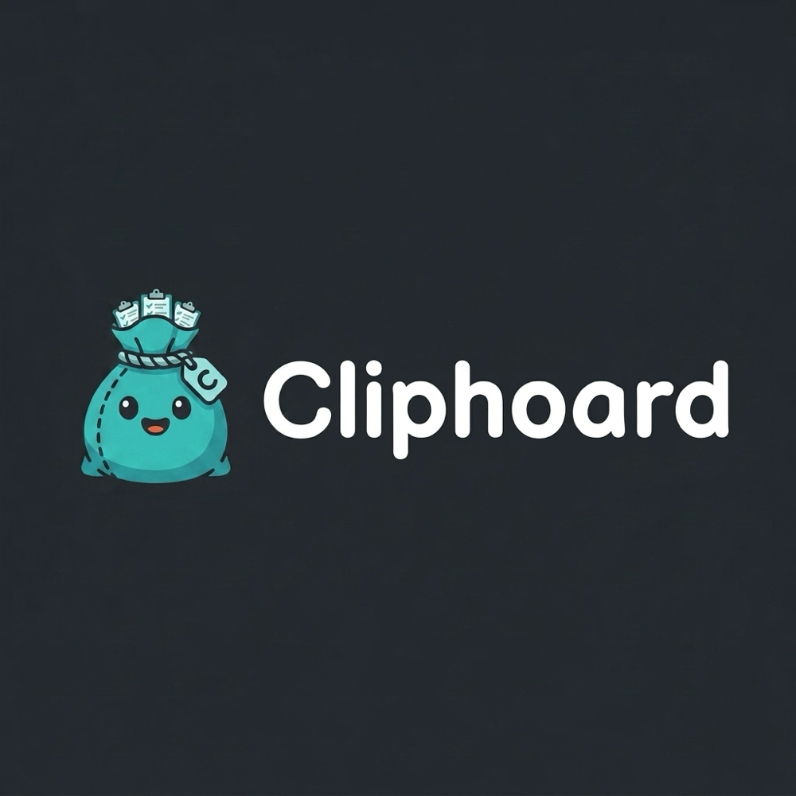
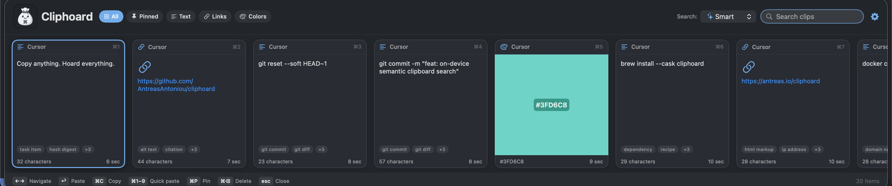
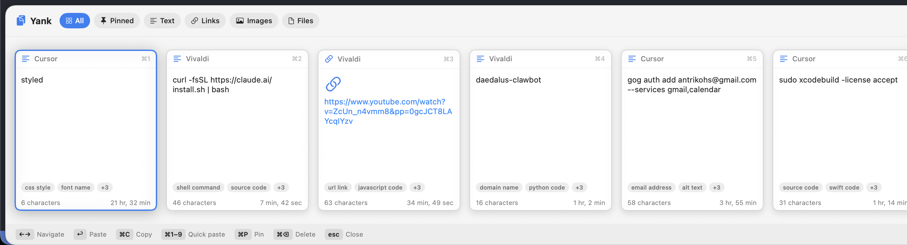
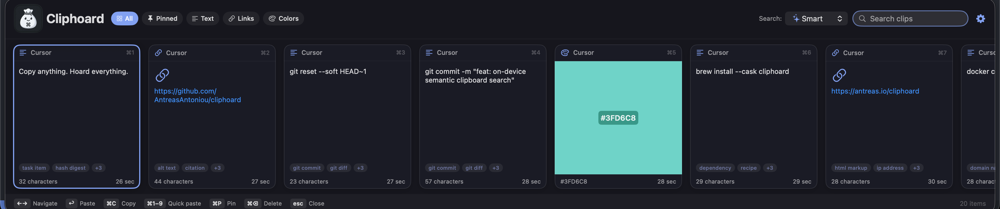

<h1 align="center"></h1>

<p align="center"><b>Copy anything. Hoard everything.</b><br>
A fast, private, open-source clipboard manager for macOS — searchable by <i>meaning</i>, entirely on your Mac.</p>

<p align="center">
  
  
  
  
  
  <a href="https://github.com/AntreasAntoniou/cliphoard/releases/latest"></a>
</p>

<p align="center"></p>

Press **⌃⌥⌘V** anywhere and your clipboard history slides up from the bottom of the
screen as a strip of cards. Pick one and it pastes straight back into whatever app
you were in. A clipboard that **hoards** everything you copy — and hands it back the
instant you need it (clip + hoard).

Built with Swift, AppKit and SwiftUI. **No Electron, no telemetry, no account, no
cloud.** Everything you copy stays on your Mac.

## Why Cliphoard

- **🔎 Smart search, on-device.** The default **Smart** mode shows your exact matches
  first, then the semantically closest clips — find "that database query" by meaning
  *and* still get the literal token you typed. Switch modes (Smart / Exact / Tag)
  right from the pill next to the search field. Three model tiers (ogma micro/small, MiniLM), each installed on first use — the ogma
  models from [HuggingFace](https://huggingface.co/axiotic/open-ogma-small) so their download
  numbers reflect real usage of a model we released, MiniLM from our GitHub release. Every model is permissively licensed (MIT or Apache-2.0). No account; your clips never touch a network.
- **🔒 Private, and provably so.** Nothing ever leaves your Mac. Clip content — text, rich
  text, file paths, colours, recognised image text, your tags **and the name of the app you
  copied from** — is **encrypted at rest** (AES-GCM) in the database, and image clips and
  their thumbnails are encrypted on disk; timestamps, clip kind, pin state and the small
  detector flags stay in the clear. The key is derived from a P-256 key generated inside the
  **Secure Enclave** where your Mac has one (a random login-Keychain key otherwise).
  Concealed pasteboards are never stored; clips from known password managers are
  quarantined — flagged and never indexed, not hidden. Open source: read it and confirm
  there are zero network calls. ([Details →](PRIVACY.md))
- **🎨 17 themes, 3 layouts.** A clean Swiss greyscale, One Dark, Dracula, Tokyo Night,
  Catppuccin and more — follows your macOS Light/Dark appearance. Card strip, compact
  list, or a Spotlight-style palette with live preview.
- **⌨️ Keyboard-first.** Summon, search, navigate, and paste without leaving the home row.
- **🧱 Everything you copy.** Text, rich text, links, hex colors, files and images — each
  detected automatically with type-appropriate previews and thumbnails.

<p align="center">
  
  <br>
  
  
</p>

## Keyboard shortcuts

| Shortcut | Action |
| --- | --- |
| `⌃⌥⌘V` | Show / hide the Cliphoard bar |
| `← →` / `↑ ↓` | Move selection |
| `↩` | Paste selected clip |
| `⌘C` / `⌃C` | Copy selected clip (no paste) |
| `⌘O` | Open the selected file clip |
| `⌥⌘C` | Copy a file clip's path as text |
| `⌥↩` | Paste selected clip as plain text |
| `⌘1`–`⌘9` | Quick-paste by position |
| `⌘P` | Pin / unpin selection |
| `⌘⌫` | Delete selection |
| `esc` | Dismiss (or close settings) |
| `⌘Q` | Quit Cliphoard |

Click a card to select it; click again to paste — except a **file** clip, where a **double-click opens** the file and ↩ (or right-click → Paste) pastes it. The toolbar **gear** opens settings
right inside the bar (theme, layout, search mode, sound, history limit, permissions).

## Install

Download the latest DMG from [**Releases**](https://github.com/AntreasAntoniou/cliphoard/releases),
drag **Cliphoard** to Applications, and press **⌃⌥⌘V**. Or build from source (below).

> **1.0.0 is not yet notarized by Apple** (the notarized build and Homebrew tap ship in 1.0.1).
> First launch: open it once, then *System Settings → Privacy & Security → Open Anyway*, or
> `xattr -dr com.apple.quarantine /Applications/Cliphoard.app`. When 1.0.1 replaces it, macOS
> treats it as a new app: re-grant Accessibility once and click **Always Allow** when Cliphoard
> asks for its keychain key (Deny freezes history read-only; nothing is deleted).

On first launch macOS asks for **Accessibility** access — Cliphoard needs it to send the
⌘V keystroke that pastes into the focused app (*System Settings → Privacy & Security →
Accessibility*). Until granted, selecting a clip still copies it; you paste manually.

## Build from source

Requires macOS 13+ and the Swift toolchain (Xcode 15+).

```bash
git clone https://github.com/AntreasAntoniou/cliphoard.git
cd cliphoard
make run          # builds Cliphoard.app and launches it
```

Other targets: `make app` (build `build/Cliphoard.app`) · `make install` (copy to /Applications) · `make build` (debug binary) · `make clean`.

## Free, and staying that way

MIT licensed. No paid tier, no locked features, no crippled build — everyone gets everything,
and `make install` above gives you the same app as the download.

If it earns a place on your Mac, you can [sponsor the
work](https://github.com/sponsors/AntreasAntoniou). That is closer to Patreon than to a shop:
you are not buying software you already have, you are funding the mission behind it —
**local-first, secure tools that are genuinely useful and a pleasure to use**.

Part of that mission is research, and some of it ships here: searching your clips *by meaning*
runs on **ogma**, text models I trained and distilled myself from open teachers (2.5M and 8.9M
parameters), built around how much capability you can get per parameter rather than how much
you can get by making everything bigger. Credit where due — reading text inside screenshots is
Apple's Vision framework, and finding images from a description uses OpenVision-Tiny, openly
licensed and not mine.

Not sponsoring is completely fine.

## Privacy

Everything is stored **locally** and **encrypted at rest** — text clips in the database
and image clips (plus their thumbnails) on disk (see PRIVACY.md). Cliphoard sends no data anywhere — its only outbound call is the optional one-time model download — and has no
telemetry, analytics, or account. Pasteboards marked transient, concealed or auto-generated
— what password managers set — are never stored; a clip that still arrives from a known
password manager is stored encrypted but quarantined: flagged "password app" and never
indexed, not hidden. Exclude any app with
`defaults write ai.a2-labs.cliphoard excludedBundleIDs -array com.example.app`. See
[PRIVACY.md](PRIVACY.md) — including **why there is, and will be, no cloud sync**.

**Moving to a new Mac:** *Settings → Move to another Mac*. The key never leaves this Mac's
Secure Enclave and login Keychain, so copying the database achieves nothing. Instead,
**Export…** writes a single encrypted `.cliphoard` file holding your whole history — clips,
images, tags, pins, dates and the app each clip came from — and **Import…** on the new Mac
decrypts it and re-seals every clip under *that* Mac's key. The whole file is sealed as one
authenticated stream (AES-256-GCM, key stretched from your passphrase with
PBKDF2-HMAC-SHA256). **Your passphrase is the only key: nothing is escrowed, a lost
passphrase cannot be recovered, and the file is as sensitive as your history itself.** New
in **1.0.1**. Headless equivalents: `--export-history <path>` and `--import-history <path>`
(passphrase on stdin, `--dry-run` to verify a file without writing anything).

## Deep search (on-device embeddings)

Beyond exact substring, Cliphoard searches **semantically**, fully on-device:

- **Smart search (default)** — exact substring matches first, then the semantically
  closest remaining clips (full vector cosine). You always get the obvious hit, plus
  meaning-based suggestions below it.
- **Exact** — literal case-insensitive substring only.
- **Tag search** — every clip is classified at ingest across four stable semantic axes
  (content type, intent, time horizon, and sensitivity) plus a curated topical pool.
  Low-confidence labels are omitted, and a query maps to the matching facet or topical
  tag for an O(1) inverted-index lookup. You can also add your own encrypted user tags.

Models run locally via **CoreML**:

| Tier | Model | Dim |
| --- | --- | --- |
| Low | [`axiotic/open-ogma-micro`](https://huggingface.co/axiotic/open-ogma-micro) | 384 / 1024 |
| Normal (default) | [`axiotic/open-ogma-small`](https://huggingface.co/axiotic/open-ogma-small) | 384 / 1024 |

Each ogma model carries two projection heads — 384-d and 1024-d — and the app uses the
1024-d one by default (Settings → Vector detail).

The tag taxonomy and confidence threshold are configurable in **Settings → Tags**
(curated baskets or your own). Open a clip's detail card to inspect automatic labels
or add and remove personal tags.
Token ids and embeddings match the PyTorch reference exactly (the tokenizer is
reimplemented in Swift). To produce/bundle the models, see [`tools/`](tools/README.md).

## How it works

| Piece | File |
| --- | --- |
| Pasteboard polling + type detection | `Sources/Cliphoard/Clipboard/ClipboardMonitor.swift` |
| History model, dedup, incremental index, trimming | `Sources/Cliphoard/Clipboard/ClipStore.swift` |
| Encrypted SQLite store (Float16 vector BLOBs, WAL) | `Sources/Cliphoard/Clipboard/Database.swift`, `Crypto.swift` |
| Global hotkey (Carbon) + slide-up panel | `Sources/Cliphoard/App/HotKey.swift`, `UI/FloatingPanel.swift` |
| Bar, cards, themes, layouts (SwiftUI) | `Sources/Cliphoard/UI/ContentView.swift`, `ClipCardView.swift`, `Theme.swift` |

## Coming in 1.0.1

- Touch ID hiding for password-manager clips
- A Settings UI for excluded apps
- The notarized build and Homebrew tap

Later: clip stack · customizable hotkey · smart actions on links & colors.

## License

MIT © Antreas Antoniou. Bundled on-device models have their own licenses — see
[THIRD-PARTY-NOTICES.md](THIRD-PARTY-NOTICES.md).
